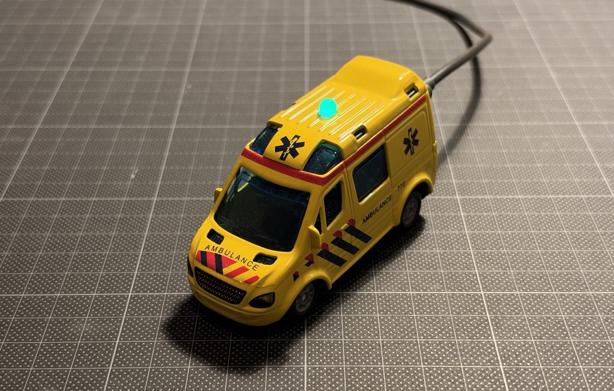

# 🚨 [sirenes.live](https://sirenes.live)

A small, always-on **ESP32** device that listens near a window, detects emergency-vehicle
sirens with an on-device TinyML model, counts them, and logs loudness and time of day.

The device hosts its own web page at `http://siren-detector.local` in my local network.
Counts and the event log live on the device (flash / LittleFS); detection audio + a durable
event database are streamed to a small self-hosted VPS archive (in [`cloud/`](cloud/)) that
powers [sirenes.live](https://sirenes.live). The archive is hosted on a VPS running [k3s-deploy](https://github.com/woudsma/k3s-deploy).

<p align="center">
  
</p>

## Features

- 🚨 On-device siren detection (Edge Impulse audio classifier).
- 🔊 Calibratable decibel (dB SPL) logging via a digital I2S MEMS mic.
- 📈 Dashboard graphs: sirens per day, time-of-day, weekday × hour heat-map, etc.
- 🌡️ Daily temperature for Amsterdam (via free [Open-Meteo](https://open-meteo.com/)) correlated
  against the siren count.
- ☁️ Self-hosted VPS archive: every detection's full-length audio + event history, with playback.
- 💡 WS2812 status LED (listening / detecting / error).
- 🔌 ~0.7–1.0 W, ≈ €2–3/year of electricity. Safe to run 24/7 (low-voltage USB, no LiPo).

## Hardware

- Toy Ambulance
- Seeed Studio XIAO ESP32S3 (8 MB flash + 8 MB PSRAM, native USB-C)
- Adafruit ICS-43434 I2S MEMS microphone
- WS2812 RGB LED
- 5 V USB wall charger

Wiring, calibration, power, and safety details are in [SPECIFICATIONS.md](SPECIFICATIONS.md).

## Tech Stack

- **Firmware:** PlatformIO, Arduino framework, ESPAsyncWebServer, FastLED, ArduinoJson, LittleFS.
- **ML:** Edge Impulse (MFE audio block + small neural net), deployed as a C++ library.
- **Web UI:** Vite + React 18 + TypeScript + Chakra UI v3.
- **Cloud archive:** Node + Express + SQLite (single service) + Open-Meteo for daily weather,
  deployed to a [k3s](https://github.com/woudsma/k3s-deploy) VPS via `git push` and served at [sirenes.live](https://sirenes.live).

## Getting Started

```bash
# Build firmware
cd firmware
~/.platformio/penv/bin/pio run

# Build + upload firmware, then the web UI filesystem
# (XIAO ESP32S3 uses native USB — find the port with: ls /dev/cu.usbmodem*)
~/.platformio/penv/bin/pio run -e seeed_xiao_esp32s3 -t upload --upload-port /dev/cu.usbmodemXXXX
~/.platformio/penv/bin/pio run -e seeed_xiao_esp32s3 -t uploadfs --upload-port /dev/cu.usbmodemXXXX

# Develop the web UI with mock data (no device needed)
cd ../ui
npm install
npm run dev

# Start the cloud app locally: API server (port 8080) + frontend dev server
./cloud/dev.sh
```

Copy `firmware/include/wifi_credentials.h.example` to `wifi_credentials.h` and set your WiFi
SSID/password before building.

## License

MIT
